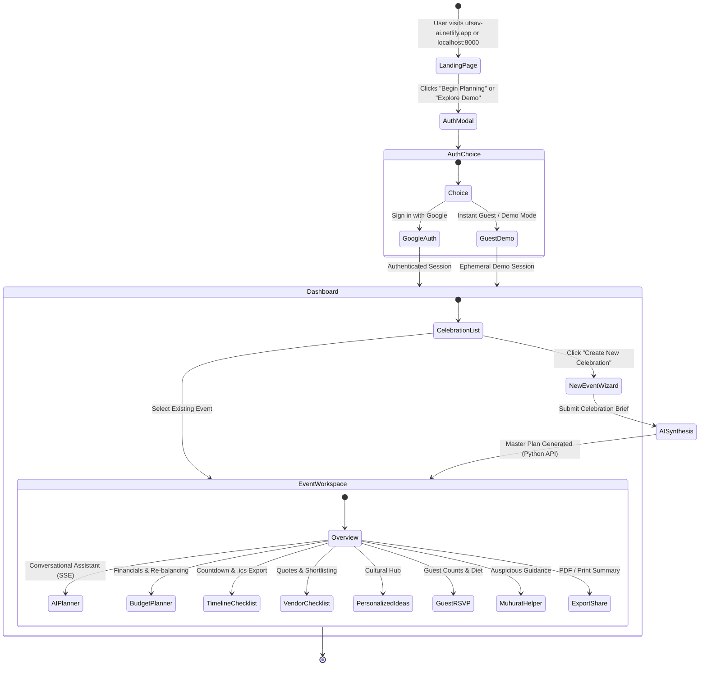
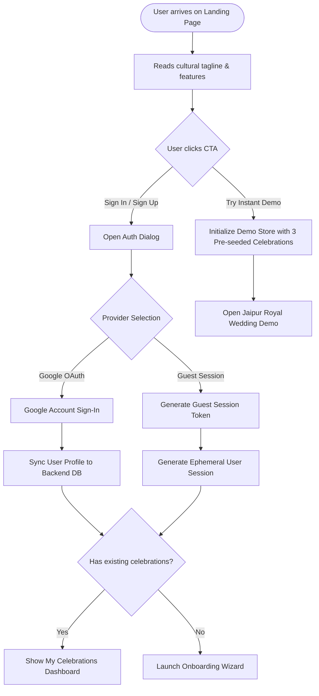
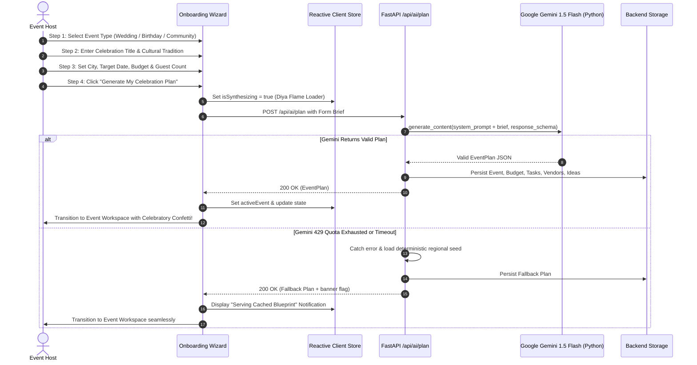
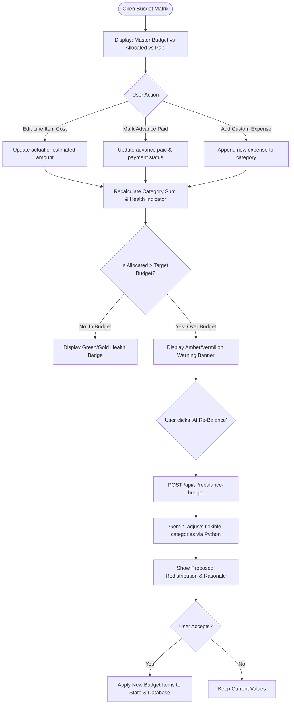
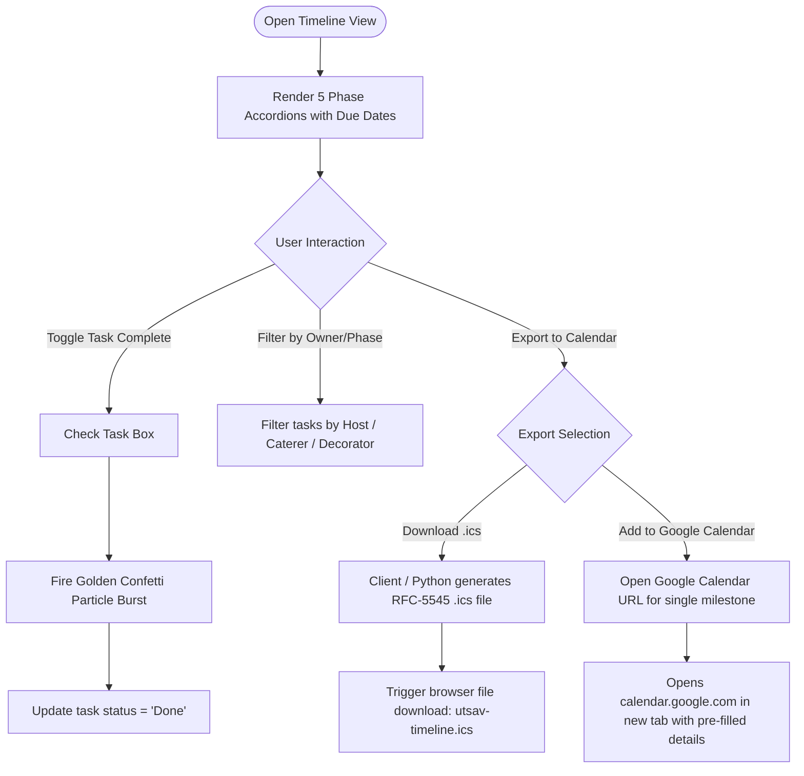
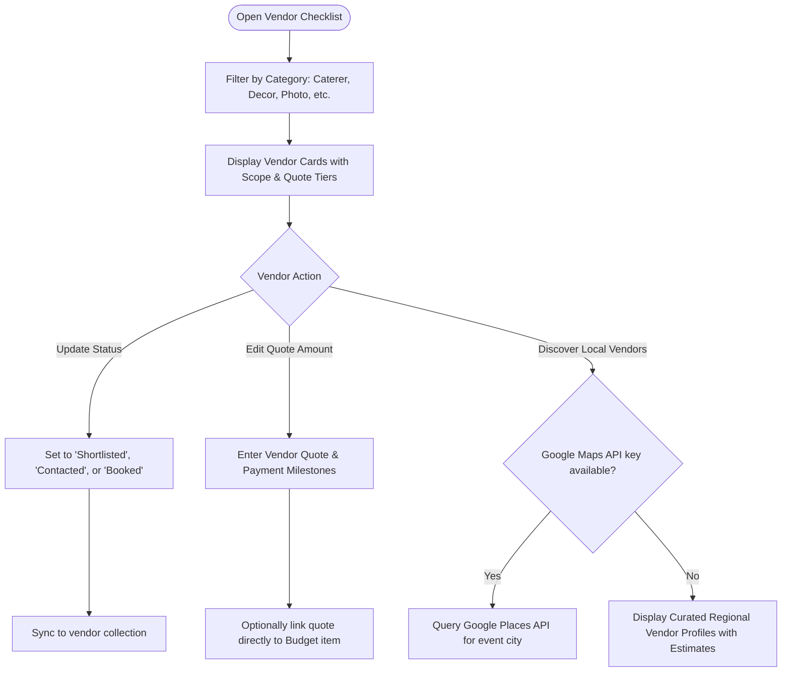
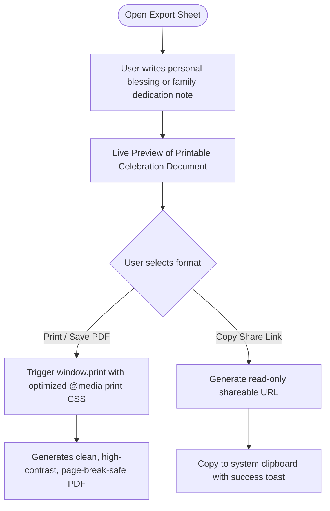
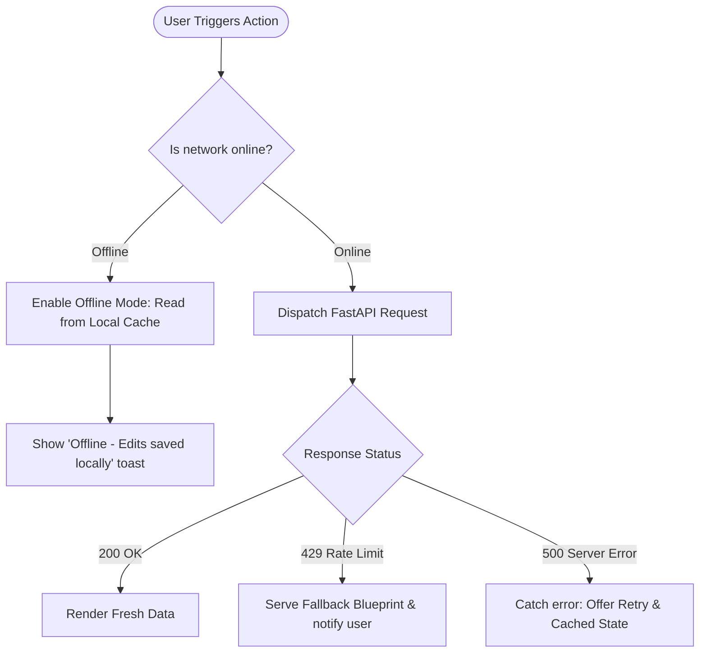

# End-to-End User & System Application Flows - Utsav (उत्सव)

**Document Version:** 1.0.0-PROD  
**Author:** Senior UX Architect & System Engineer  
**Date:** 2026-10-23  

---

## 1. High-Level User Journey Overview

---

## 2. Detailed Sub-System Flowcharts

### 2.1 First-Time User & Authentication Flow

---

### 2.2 Event Creation & AI Master Plan Generation Flow

---

### 2.3 Budget Management & AI Re-Balancing Flow

---

### 2.4 Timeline Management & Google Calendar Export Flow

---

### 2.5 Vendor Discovery & Shortlisting Flow

---

### 2.6 Export, Share & Blessing Note Flow

---

### 2.7 Error Resilience & Graceful Offline Path

