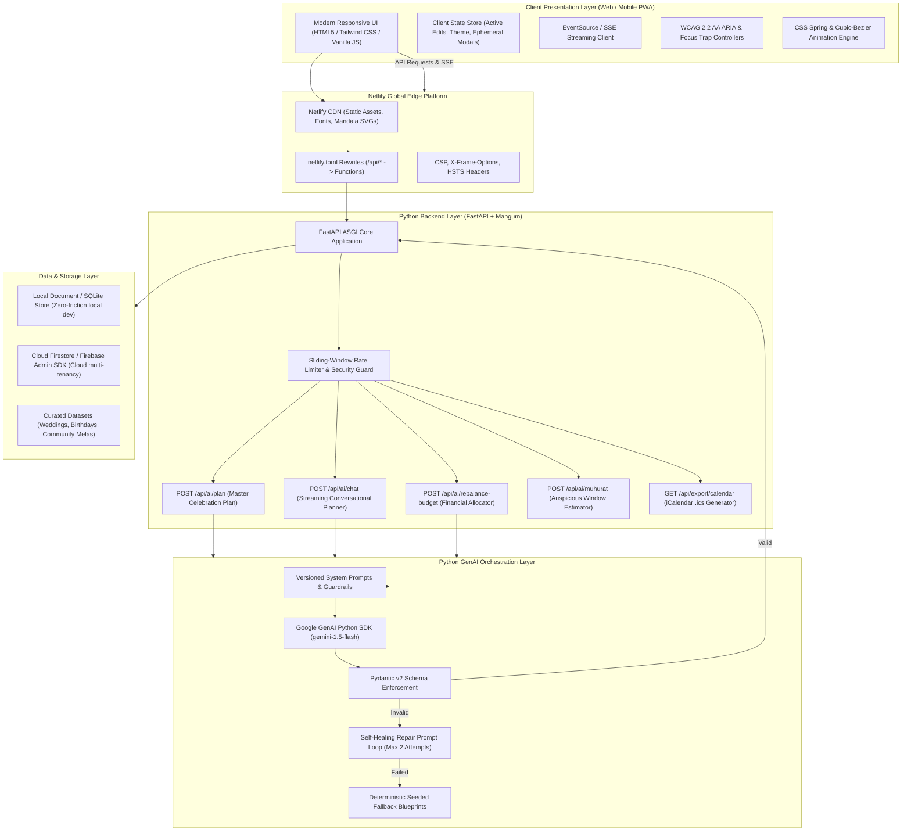
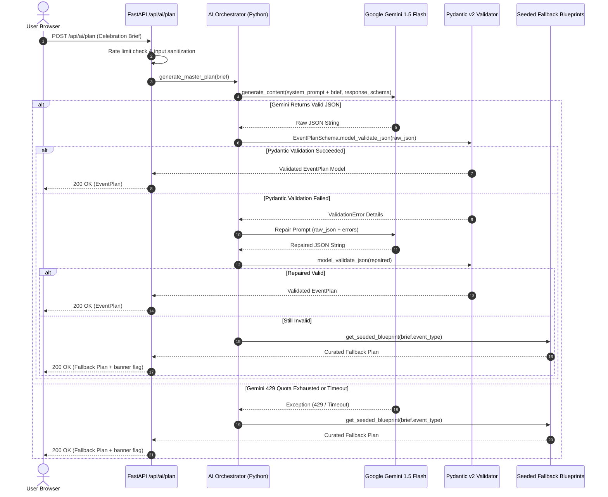

# Technical Architecture Specification - Samaroh (समारोह)

**Product Name:** Samaroh (समारोह)  
**System Architecture Version:** 1.0.0-PROD  
**Author:** Senior Software Architect  
**Date:** 2026-10-23  

---

## 1. High-Level System Architecture

Samaroh is architected as an asynchronous **Python-Native Full-Stack Application** powered by **FastAPI**, **Pydantic v2**, and the official **Google GenAI Python SDK**. It is engineered for dual execution: locally via a high-performance **Uvicorn** server, and in cloud production via **Netlify Serverless Functions** (powered by Mangum / AWS Lambda) coupled with a global edge CDN for static assets.

### 1.1 Architecture Topology Diagram



---

## 2. Layer-by-Layer Architectural Breakdown

### 2.1 Presentation & UI Layer (Client)
- **Serving:** Static HTML5, modular JavaScript ES modules, and Tailwind CSS served directly by Netlify's global edge network (or by FastAPI's `StaticFiles` during local execution).
- **Styling & Assets:** Tailwind CSS with CSS custom properties (variables) for theme tokens (`--bg-primary`, `--accent-saffron`, `--accent-gold`, etc.), Google Fonts (*Noto Serif Devanagari* and *Plus Jakarta Sans*), and Lucide icon SVGs.
- **State Management:** Reactive vanilla JS store implementing publish-subscribe patterns for instant UI updates, tab changes, and budget tickers.
- **Streaming Client:** Uses native browser `fetch` with `ReadableStream` reader (or `EventSource`) to receive SSE tokens from the FastAPI `/api/ai/chat` endpoint and render markdown in real time.

### 2.2 API & Backend Framework (FastAPI)
- **Core Engine:** FastAPI 0.110+ on Python 3.10/3.13.
- **Serverless Adapter:** `mangum` transforms FastAPI's ASGI interface into standard AWS Lambda / Netlify Function handler format (`handler = Mangum(app)`).
- **Validation:** Pydantic v2 provides compile-time and runtime validation with automatic OpenAPI 3.1 spec generation (`/docs`).
- **Security Middleware:** Custom FastAPI middleware for Content Security Policy, CORS allowlisting, and sliding-window rate limiting.

### 2.3 GenAI Orchestration Layer
The orchestration engine handles structured outputs and conversational streaming with resilient self-healing:



---

## 3. Directory & Folder Structure

The repository maintains strict Python best practices:

```
samaroh-event-planner/
├── .github/
│   └── workflows/
│       └── ci.yml               # Automated Lint, Mypy, Pytest & Netlify Deploy Check
├── docs/                        # Complete Phase 1 Documentation Deliverables
│   ├── PRD.md
│   ├── ARCHITECTURE.md
│   ├── AGENTS.md
│   ├── DECISIONS.md
│   ├── TASKS.md
│   ├── TRD.md
│   ├── APP_FLOW.md
│   ├── UI_UX_FLOW.md
│   ├── SECURITY_AND_TESTING.md
│   ├── BACKEND_SCHEMA.md
│   ├── IMPLEMENTATION_PLAN.md
│   └── STAGE_STATUS.md
├── netlify/
│   └── functions/               # Netlify Serverless Function Handlers
│       ├── api.py               # Mangum entrypoint wrapping FastAPI app
│       └── requirements.txt     # Python serverless dependencies
├── public/                      # Vanilla JS Single Page Application (0 external build steps)
│   ├── index.html               # Main semantic HTML shell & modular templates
│   ├── favicon.svg              # Saffron Devanagari ॥ vector favicon
│   ├── css/
│   │   └── styles.css           # Modern minimal aesthetic & WCAG 2.2 AA theme system
│   └── js/
│       ├── app.js               # UI controller, view renderers, and event handlers
│       ├── auth.js              # Firebase authentication client & token management
│       ├── store.js             # Reactive event store and state machine
│       └── api.js               # Typed async HTTP & SSE API client
├── src/
│   ├── __init__.py
│   ├── main.py                  # FastAPI Application Factory, GZip & security middleware
│   ├── config.py                # Centralized settings & immutable security headers
│   ├── api/                     # Route Handlers
│   │   ├── __init__.py
│   │   ├── ai_routes.py         # /api/ai/plan, /api/ai/chat, /api/ai/rebalance, /api/ai/muhurat
│   │   ├── event_routes.py      # /api/events CRUD, tasks, vendors, ideas, and guests
│   │   ├── export_routes.py     # /api/export/calendar, summary, share-token, gcal deep-link
│   │   └── places_routes.py     # /api/places/search Google Places discovery proxy
│   ├── models/                  # Pydantic v2 Models with ConfigDict(extra='forbid')
│   │   ├── __init__.py
│   │   ├── ai_plan.py           # Unified EventMasterPlan schema
│   │   ├── budget.py            # BudgetItem & AI re-balance schemas
│   │   ├── event.py             # Event metadata & CelebrationBrief
│   │   ├── guest.py             # GuestItem, party size & RSVP status schemas
│   │   ├── ideas.py             # Cultural suggestion dimensions & IdeaItem
│   │   ├── timeline.py          # Milestone tasks and status schemas
│   │   └── vendor.py            # Vendor quotes and categories
│   ├── services/                # Business Logic & External Integrations
│   │   ├── __init__.py
│   │   ├── gemini_service.py    # Google GenAI SDK orchestration & response cache
│   │   ├── storage_service.py   # Multi-tenant Firestore & local disk JSON store
│   │   ├── places_service.py    # Google Places API proxy & curated cultural registry
│   │   └── calendar_service.py  # RFC-5545 iCalendar generation
│   ├── data/                    # Curated Seed Celebrations
│   │   ├── __init__.py
│   │   ├── wedding_jaipur.py    # 350-guest Royal Rajasthani Wedding Seed
│   │   ├── birthday_blr.py      # 45-guest Cosmic Space Explorer Birthday Seed
│   │   └── community_delhi.py   # 800-resident Society Diwali Mela Seed
│   └── utils/
│       ├── __init__.py
│       ├── app_check.py         # Firebase App Check attestation token validator
│       ├── auth.py              # Firebase ID token verification & claim validator
│       ├── currency.py          # Indian Lakh/Crore number formatting
│       ├── rate_limiter.py      # Sliding-window rate limiter with standard headers
│       ├── sanitizer.py         # Prompt injection & input sanitization
│       └── tokens.py            # HMAC-SHA256 signed share & export tokens
├── tests/                       # Comprehensive Automated Test Suite (245+ tests)
│   ├── conftest.py              # Pytest fixtures and test clients
│   ├── security/                # Dedicated Security & Hardening Suite
│   │   ├── test_error_schema.py
│   │   ├── test_frontend_xss.py
│   │   ├── test_idor.py
│   │   ├── test_input_boundaries.py
│   │   ├── test_prompt_injection.py
│   │   ├── test_rate_limiter.py
│   │   ├── test_security_headers.py
│   │   ├── test_share_tokens.py
│   │   ├── test_supply_chain.py
│   │   └── test_token_verification.py
│   ├── test_accessibility_axe.py# Automated axe-core accessibility matrix (WCAG AA)
│   ├── test_performance_and_vitals.py # Web Vitals (LCP/CLS/TTFT) & bundle audit
│   ├── test_e2e_journeys.py     # Playwright user planning journeys
│   ├── test_frontend_store_api.py # Frontend store, api client & OpenAPI sync
│   ├── test_mock_integrations.py# Gemini API repair loop & calendar compliance
│   ├── test_edge_cases.py       # Numerical boundaries & Devanagari preservation
│   ├── test_places_contract.py  # Google Maps Places API contract tests
│   └── test_firestore_rules_matrix.py # Multi-tenant security rules matrix
├── docs/                        # Architectural, Verification, and Status Docs
│   ├── reports/                 # Audit artifacts (ui-after/, accessibility, performance, load)
│   ├── ARCHITECTURE.md          # System design & topology specification
│   ├── STAGE_STATUS.md          # Real stage gate log with verified commit SHAs
│   ├── TASKS.md                 # Detailed checklist across stages R0-R8
│   ├── TRD.md                   # Technical requirements & bundle metrics
│   └── DECISIONS.md             # Architecture Decision Records (ADR-001..ADR-013)
├── .github/workflows/ci.yml     # Multi-job GitHub Actions CI/CD Pipeline
├── Dockerfile                   # Multi-stage non-root container for Google Cloud Run
├── netlify.toml                 # Netlify Build, Functions & Edge Redirects
├── requirements.txt             # Project Python Dependencies
├── pyproject.toml               # Tool configuration (ruff, pytest, mypy)
├── run.py                       # Single-command local runner (`python run.py`)
└── README.md                    # Root project documentation & services matrix
```

---

## 4. Netlify Deployment Architecture

### 4.1 `netlify.toml` Configuration
```toml
[build]
  publish = "public"
  functions = "netlify/functions"

[functions]
  python_version = "3.11"

[[redirects]]
  from = "/api/*"
  to = "/.netlify/functions/api/:splat"
  status = 200

[[headers]]
  for = "/*"
  [headers.values]
    X-Frame-Options = "DENY"
    X-Content-Type-Options = "nosniff"
    Referrer-Policy = "strict-origin-when-cross-origin"
```

### 4.2 Serverless Wrapper (`netlify/functions/api.py`)
```python
from mangum import Mangum
from src.main import app

# Mangum adapts FastAPI's ASGI app for Netlify / AWS Lambda serverless execution
handler = Mangum(app, lifespan="off")
```

---

## 5. Observability & Telemetry

- **Structured JSON Logging:** FastAPI middleware logs request timing, endpoint paths, client IP hashes, and Gemini inference latency.
- **Health Checks:** `/api/health` reports status of the Python runtime, active memory usage, and Gemini API connectivity.
- **Client Error Boundary:** In-browser error handlers catch network interruptions and seamlessly transition to local offline cache.
