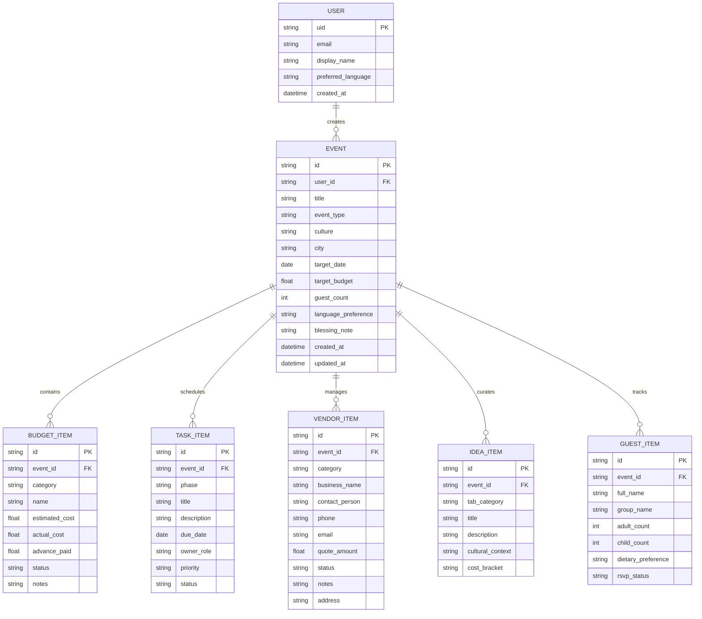

# Database Schema & Pydantic Data Models - Utsav (उत्सव)

**Document Version:** 1.0.0-PROD  
**Author:** Senior Backend Engineer & Data Architect  
**Date:** 2026-10-23  

---

## 1. Entity-Relationship Diagram (ERD)



---

## 2. Python Pydantic v2 Schema Definitions

These schemas live in `src/models/` and serve as the single source of truth for FastAPI request/response validation, Gemini structured outputs, and database persistence.

### 2.1 Event Schema (`src/models/event.py`)
```python
from enum import Enum
from typing import Optional
from datetime import date, datetime
from pydantic import BaseModel, Field

class EventType(str, Enum):
    WEDDING = "wedding"
    BIRTHDAY = "birthday"
    COMMUNITY = "community"
    FESTIVAL = "festival"
    OTHER = "other"

class EventBase(BaseModel):
    title: str = Field(..., min_length=2, max_length=100, description="Celebration title")
    event_type: EventType = Field(..., description="Category of celebration")
    culture: str = Field(..., min_length=2, max_length=60, description="Cultural or regional tradition")
    city: str = Field(..., min_length=2, max_length=60, description="Host city")
    target_date: Optional[date] = Field(None, description="Event date (YYYY-MM-DD)")
    target_budget: float = Field(..., gt=0, le=100_000_000, description="Budget in INR")
    guest_count: int = Field(..., gt=0, le=50_000, description="Estimated guest count")
    language_preference: str = Field("en", description="UI/AI language ('en' or 'hi')")
    blessing_note: Optional[str] = Field(None, max_length=300, description="Family blessing note")

class EventCreate(EventBase):
    pass

class EventResponse(EventBase):
    id: str
    user_id: str
    created_at: datetime
    updated_at: datetime
```

### 2.2 Budget Schema (`src/models/budget.py`)
```python
class PaymentStatus(str, Enum):
    PENDING = "pending"
    PARTIAL = "partial"
    PAID = "paid"

class BudgetItem(BaseModel):
    id: str = Field(..., description="Unique line item ID")
    event_id: str
    category: str = Field(..., description="e.g., Venue, Catering, Decor, Photography")
    name: str = Field(..., description="Name of expense item")
    estimated_cost: float = Field(..., ge=0)
    actual_cost: float = Field(0.0, ge=0)
    advance_paid: float = Field(0.0, ge=0)
    status: PaymentStatus = PaymentStatus.PENDING
    notes: Optional[str] = None
```

### 2.3 Timeline Schema (`src/models/timeline.py`)
```python
class TaskPriority(str, Enum):
    HIGH = "high"
    MEDIUM = "medium"
    LOW = "low"

class TaskStatus(str, Enum):
    TODO = "todo"
    IN_PROGRESS = "in_progress"
    DONE = "done"

class TaskItem(BaseModel):
    id: str
    event_id: str
    phase: str = Field(..., description="e.g., Phase 1: Foundation, Phase 5: Day-Of")
    title: str
    description: str
    due_date: Optional[date] = None
    owner_role: str = Field("Host", description="Assigned role: Host, Caterer, Uncle, etc.")
    priority: TaskPriority = TaskPriority.MEDIUM
    status: TaskStatus = TaskStatus.TODO
```

### 2.4 Unified Master Plan Schema for Gemini (`src/models/ai_plan.py`)
```python
class EventMasterPlan(BaseModel):
    celebration_title: str
    event_type: str
    cultural_summary: str
    target_budget: float
    guest_count: int
    budget_breakdown: list[BudgetItem]
    timeline_tasks: list[TaskItem]
    vendor_checklist: list[VendorItem]
    personalized_ideas: list[IdeaItem]
    auspicious_guidance: Optional[str] = None
    disclaimer: str = "Estimates provided for planning purposes only."
```

---

## 3. Curated Seed Data

### 3.1 Jaipur Royal Destination Wedding (Marwari Vivaha)
- **ID:** `demo-wedding-jaipur`
- **Title:** *Riya & Kabir's Royal Sangeet & Vivaha*
- **Budget:** ₹45,00,000 | **Guests:** 350 | **City:** Jaipur, Rajasthan
- **Tradition:** Marwari Hindu with Mehendi, Sangeet, Pheras, and Reception.
- **Key Categories:** Palace Courtyard Venue, Royal Rajasthani Halwai, Genda/Rose Floral Decor, Folk & Dhol Performance, Traditional Mehendi Artists.

### 3.2 Bengaluru Urban Themed Birthday
- **ID:** `demo-birthday-blr`
- **Title:** *Aarav's 5th Cosmic Space Explorer Adventure*
- **Budget:** ₹85,000 | **Guests:** 45 | **City:** Bengaluru, Karnataka
- **Tradition:** Contemporary Indian Urban.
- **Key Categories:** Clubhouse Hall, Planet-Themed Custom Fondant Cake, Interactive Science Magic Show, Planetarium Scavenger Hunt, Seed-Paper Return Hampers.

### 3.3 Delhi NCR Society Diwali Mela & Dandiya Night
- **ID:** `demo-community-delhi`
- **Title:** *Gulmohar Enclave Grand Diwali Mela & Dandiya Utsav*
- **Budget:** ₹6,50,000 | **Guests:** 800 | **City:** Dwarka, New Delhi
- **Tradition:** Inter-community Northern / Western Celebration.
- **Key Categories:** RWA Amphitheatre, Fire & Sound Municipal Clearances, Dandiya Live Troupe, Rangoli Competition Stalls, 100% LED Diya Illumination.

---

## 4. Multi-Tenant Security & Access Rules

1. All database queries filter strictly by `WHERE user_id = :authenticated_user_id` (or anonymous session ID).
2. Demo mode uses dedicated isolated read-only seed records with in-memory local override to prevent cross-user contamination.
3. Cascading deletion is executed atomically if an event is deleted.
