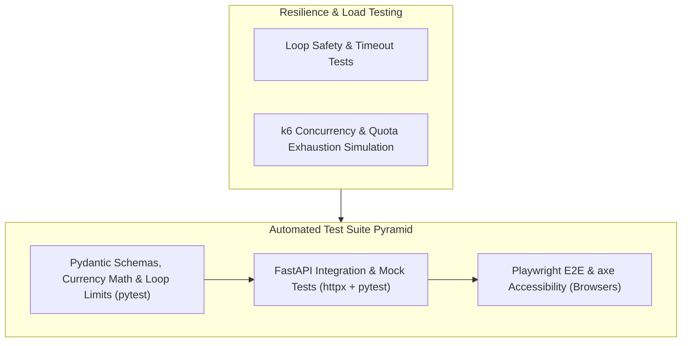

# Security Architecture & Comprehensive Testing Plan - Samaroh (समारोह)

**Document Version:** 1.0.0-PROD  
**Author:** Senior Cybersecurity Engineer & Lead QA Architect  
**Date:** 2026-10-23  

---

## Part 1: Security Architecture & Threat Model

### 1.1 STRIDE Threat Modeling Analysis
| Threat Category | Potential Attack Vector | Applied Countermeasure in Samaroh |
|---|---|---|
| **Spoofing** | Attacker impersonating another host to view guest lists. | Authenticated session token verified on every route; guest mode generates high-entropy UUIDs. |
| **Tampering** | Man-in-the-middle tampering with budget amounts or quotes. | Mandatory HTTPS on Netlify CDN; strict Pydantic v2 type casting and range limits (`gt=0`). |
| **Repudiation** | Denying an approved budget re-balancing or vendor change. | Timestamps and change records stored on updated documents. |
| **Information Disclosure** | Leakage of Gemini API credentials in frontend bundle. | Zero client-side API keys. All GenAI calls execute exclusively on Python backend/Netlify Functions. |
| **Denial of Service** | Flooding Gemini endpoints to drain API quota or budget. | In-memory sliding-window rate limiter (15 requests/10 min) + Netlify DDoS mitigation. |
| **Elevation of Privilege** | Escalating from viewer to owner of another event. | Multi-tenant tenant-isolation check on every DB query (`WHERE user_id == session.uid`). |

---

### 1.2 GenAI Prompt Injection & Jailbreak Defense
1. **Input Boundary Encapsulation:**
   User briefs and chat messages are stripped of control characters and wrapped in strict XML framing tags before feeding into Gemini:
   ```python
   def sanitize_prompt_input(raw_text: str) -> str:
       # Strip markdown command injection and system overrides
       cleaned = re.sub(r"[\r\n]{3,}", "\n\n", raw_text.strip())
       cleaned = cleaned.replace("SYSTEM:", "").replace("ASSISTANT:", "")
       return cleaned[:1000]
   ```
2. **Schema Enforcement:** Gemini is forced to respond in `application/json` conforming strictly to `EventMasterPlan.model_json_schema()`. Any free-form malicious instructions in user input are rejected by the Pydantic parser.
3. **Loop Defense & Max-Iteration Caps:**
   - AI repair prompts are hard-capped at **1 retry** (`max_retries = 1`).
   - Hard execution timeout enforced via `asyncio.wait_for(gemini_call, timeout=12.0)`.
   - If repair fails or times out, the system immediately drops to the curated deterministic regional seed. Under no circumstances can an infinite generation loop occur.

---

### 1.3 Security Headers & Content Security Policy (CSP)
Configured via `netlify.toml` and FastAPI middleware:
```http
Content-Security-Policy: default-src 'self'; script-src 'self' 'unsafe-inline' https://cdn.jsdelivr.net; style-src 'self' 'unsafe-inline' https://fonts.googleapis.com; font-src 'self' https://fonts.gstatic.com; img-src 'self' data: https:; connect-src 'self' https://generativelanguage.googleapis.com; frame-ancestors 'none';
X-Content-Type-Options: nosniff
X-Frame-Options: DENY
Referrer-Policy: strict-origin-when-cross-origin
Strict-Transport-Security: max-age=31536000; includeSubDomains; preload
```

---


---

### 1.4 Authentication Coverage Matrix & Route Guards

All API endpoints are strictly governed by FastAPI dependency injection. Non-allowlisted routes require either verified Firebase ID token authentication or user/demo resolution.

#### Public Allowlist
The following routes are explicitly exempt from token requirements:
- `GET /api/health` and `GET /health` (Operational health probe)
- `GET /` (Static frontend landing page)
- `GET /static/*` (Static CSS, JS, image assets)
- `GET /api/docs`, `GET /api/redoc`, `GET /api/openapi.json` (OpenAPI documentation)

#### Guarded Route Matrix
| HTTP Method | Route | Auth Dependency | Access Rule / Purpose | Test Name |
|---|---|---|---|---|
| `POST` | `/api/ai/plan` | `require_authenticated_user` | Mutating: synthesizes plan, persists under `user_id`. Requires valid Bearer token. | `test_mutating_routes_require_authentication` |
| `POST` | `/api/ai/rebalance-budget` | `require_authenticated_user` | Mutating: rebalances category costs via Gemini financial agent. | `test_mutating_routes_require_authentication` |
| `POST` | `/api/ai/chat` | `get_current_user_or_demo` | Read/Streaming: conversational assistant via SSE. | `test_every_route_has_auth_guard_or_is_allowlisted` |
| `GET` | `/api/ai/muhurat` | `get_current_user_or_demo` | Read: auspicious seasonal timing with Vedic disclaimer. | `test_every_route_has_auth_guard_or_is_allowlisted` |
| `GET` | `/api/places/search` | `get_current_user_or_demo` | Read: proxied venue/vendor discovery without leaking API keys. | `test_every_route_has_auth_guard_or_is_allowlisted` |
| `GET` | `/api/events` | `get_current_user_or_demo` | Read: lists user's private celebrations + public demo templates. | `test_every_route_has_auth_guard_or_is_allowlisted` |
| `GET` | `/api/events/{id}` | `get_current_user_or_demo` | Read: demo-* public; private events require matching `user_id` (403 IDOR). | `test_private_celebration_idor_enforcement` |
| `DELETE` | `/api/events/{id}` | `require_authenticated_user` | Mutating: delete celebration. demo-* returns 403; private requires owner. | `test_demo_celebrations_are_strictly_read_only`, `test_private_celebration_idor_enforcement` |
| `POST` | `/api/events/{id}/clone` | `require_authenticated_user` | Mutating: clones demo or own celebration into caller's workspace. | `test_clone_demo_celebration_to_user` |
| `GET` | `/api/events/{id}/budget` | `get_current_user_or_demo` | Read: demo-* public; private events require matching `user_id`. | `test_private_celebration_idor_enforcement` |
| `PUT` | `/api/events/{id}/budget` | `require_authenticated_user` | Mutating: update budget line items. demo-* returns 403; private requires owner. | `test_demo_celebrations_are_strictly_read_only` |
| `GET` | `/api/events/{id}/tasks` | `get_current_user_or_demo` | Read: demo-* public; private events require matching `user_id`. | `test_private_celebration_idor_enforcement` |
| `POST` | `/api/events/{id}/tasks/{id}/toggle` | `require_authenticated_user` | Mutating: toggle milestone status. demo-* returns 403; private requires owner. | `test_demo_celebrations_are_strictly_read_only` |
| `GET` | `/api/events/{id}/vendors` | `get_current_user_or_demo` | Read: demo-* public; private events require matching `user_id`. | `test_every_route_has_auth_guard_or_is_allowlisted` |
| `GET` | `/api/events/{id}/ideas` | `get_current_user_or_demo` | Read: demo-* public; private events require matching `user_id`. | `test_every_route_has_auth_guard_or_is_allowlisted` |
| `GET` | `/api/events/{id}/guests` | `get_current_user_or_demo` | Read: demo-* public; private events require matching `user_id`. | `test_private_celebration_idor_enforcement` |
| `POST` | `/api/events/{id}/guests` | `require_authenticated_user` | Mutating: add guest. demo-* returns 403; private requires owner. | `test_demo_celebrations_are_strictly_read_only` |
| `POST` | `/api/events/{id}/guests/{id}/rsvp` | `require_authenticated_user` | Mutating: update RSVP. demo-* returns 403; private requires owner. | `test_demo_celebrations_are_strictly_read_only` |
| `GET` | `/api/export/{id}/calendar` | `get_current_user_or_demo` | Read: RFC-5545 .ics generation. demo-* public; private requires owner. | `test_private_celebration_idor_enforcement` |
| `GET` | `/api/export/{id}/next-milestone-link` | `get_current_user_or_demo` | Read: GCal link for next milestone. demo-* public; private requires owner. | `test_every_route_has_auth_guard_or_is_allowlisted` |
| `GET` | `/api/export/{id}/summary` | `get_current_user_or_demo` | Read: printable celebration export. demo-* public; private requires owner. | `test_private_celebration_idor_enforcement` |


## Part 2: Comprehensive Testing Strategy



---

### 2.1 Test Matrix & Scenarios

| Test File | Type | What is Tested | Acceptance Threshold |
|---|---|---|---|
| `tests/test_budget_math.py` | Unit | Live totals, percentage split, advance payments, over-budget detection. | 100% pass, ≥ 95% line coverage |
| `tests/test_schemas.py` | Unit | Pydantic v2 validation, empty titles, negative budgets, date parsing. | 100% pass |
| `tests/test_api_routes.py` | Integration | FastAPI TestClient endpoints (`/api/ai/plan`, `/api/ai/rebalance`, `/api/export/calendar`). | 100% pass |
| `tests/test_gemini_mock.py` | Integration | Gemini response parsing, repair prompt trigger, 429 quota exhaustion fallback. | 100% pass |
| `tests/test_edge_cases.py` | Edge Cases | Max-length inputs, Devanagari text, zero budgets, past dates, huge guest counts. | 100% pass |
| `tests/test_loop_safety.py` | Resilience | Infinite loop prevention: ensures AI agent stops at max-iteration (1) and timeout (12s). | 100% pass |
| `tests/load/k6_load_test.js` | Load | 50 concurrent virtual users querying health and demo endpoints. | p95 latency < 400ms, 0% errors |

---

### 2.2 Loop Testing Specification
To prevent agent and retry loops from running unbounded:
1. **Scenario 1:** Gemini continuously returns malformed JSON.
   - *Verification:* The repair loop executes exactly once, catches the second validation error, and immediately returns the fallback seed without re-querying Gemini.
2. **Scenario 2:** Gemini API hangs or experiences upstream network partition.
   - *Verification:* `asyncio.wait_for` triggers after 12.0 seconds, logs a warning, and returns the fallback seed within 50ms.

---

### 2.3 Pre-Submission QA Quality Gate Checklist
- [ ] Zero API keys exposed in client code or Git repository history.
- [ ] All 12 documentation files present and complete in `/docs` and `README.md`.
- [ ] Application launches locally with single command: `python run.py`.
- [ ] Netlify configuration verified with `netlify.toml` and Mangum serverless entrypoint.
- [ ] All 4 core pillars functional for Weddings, Birthdays, and Community events.
- [ ] Demo mode operational with 3 seeded celebrations.
- [ ] WCAG 2.2 AA accessibility verified with `@axe-core`.
